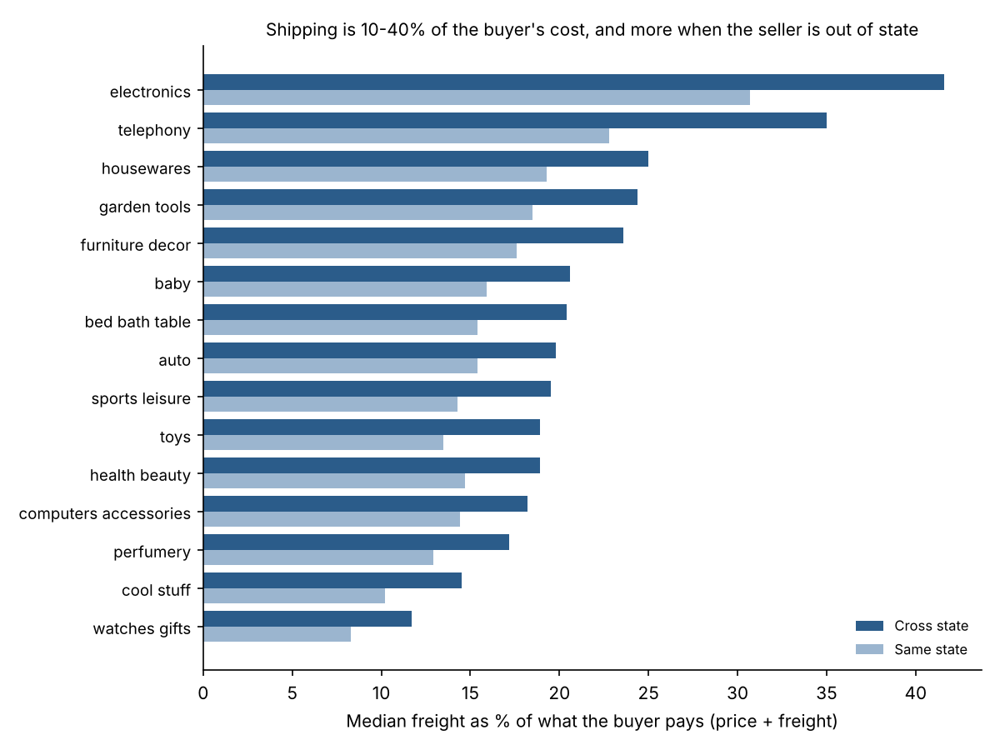
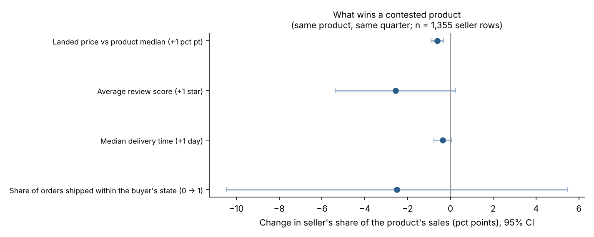
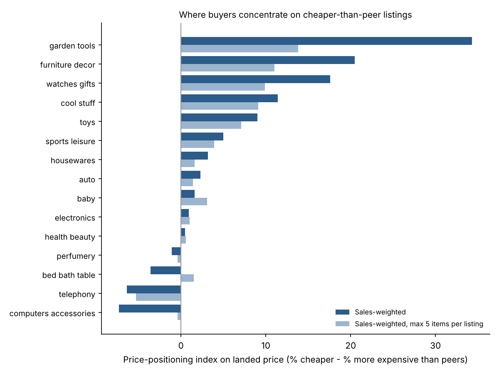

# Marketplace Price Competitiveness: Does the Cheapest Seller Win, and What Does "Cheapest" Mean?

## TL;DR
- **Question:** On a multi-seller marketplace, how much does price decide who gets the sale, and is item price even the right price to compete on?
- **Answer:** Price matters, but on **landed price** (item + shipping), not item price alone. When sellers compete for the same product in the same quarter, each 1% above the product's median landed price costs a seller about **0.6 percentage points of the product's sales**. Shipping is a median **19%** of what buyers pay, and **21%** when the seller is in another state. In 26% of contested products, the seller with the cheapest item is *not* cheapest once shipping is added.
- **Recommendation:** Target shipping cost, not only item price. Test a cross-state shipping discount in the price-sensitive, freight-heavy categories this analysis identifies (garden tools, furniture & decor, housewares), measured by GMV per buyer with subsidy cost as a guardrail.

## Business context
Marketplaces run price programs (price matching, bidding for a "buy box", subsidies) on the assumption that the cheapest offer wins. Two things can break that assumption: most products may not have competing sellers at all, and buyers pay shipping on top of the item price. This project measures both, then builds a marketplace-wide price-positioning index that covers every sale, not only the small contested slice.

## Data
- **Source:** Olist, *Brazilian E-Commerce Public Dataset* (Kaggle), licence CC BY-NC-SA 4.0. Downloaded by `scripts/download_data.py` from Olist's public GitHub repository. Raw CSVs are not committed.
- **Scope:** 112,650 order items, 99,441 orders, 32,951 products, 3,095 sellers, Brazil. Prices in BRL.
- **Analysis window:** Jan 2017 to Aug 2018 (20 months, 111,752 items). 2016 is sparse (349 items, no November) and Sep 2018 has one item.
- **Grain:** one row per order item (one unit sold). There are no listings, page views or unsold offers: only sales.

## Data quality checks
From `sql/01_data_quality.sql`:

| Check | Rows | Decision |
|---|---:|---|
| Canceled or unavailable orders | 1,234 | Exclude |
| Orders with more than one review row | 547 | Average reviews per order **before** joining, so items are not duplicated |
| Products without a category | 610 | Label "unknown"; left out of the category index |
| Products without weight | 6 | Left out of the index (weight band is part of the peer group) |
| Items with free shipping | 383 | Keep: genuine zero freight |
| Duplicate order-item keys | 0 | None |

The cleaned item table has exactly the expected 112,101 rows after exclusions, confirming the review join did not fan out.

## Method
**1. Coverage:** how many products have more than one seller, over the whole window and in the same quarter.

**2. Freight:** freight share = freight ÷ (price + freight), by category and by whether the seller and buyer are in the same state.

**3. Contested products:** a product-quarter with 2+ sellers (662 groups, 1,409 seller rows). Each seller's share of that product-quarter's items is regressed on its landed price vs the product median, review score, delivery time and same-state share, with **product-quarter fixed effects**. This compares sellers of the *same* product in the *same* quarter, so product popularity and seasonality drop out. Standard errors are clustered by product (`scripts/05_analysis.py`).

**4. Marketplace price-positioning index** (covers 88% of items):
- Listing-month = one product, one seller, one month, at its median price.
- Peer group = same category × weight band × month, with at least 10 listings.
- Position = price ÷ peer median: *Cheaper* below 0.95, *Equal* 0.95–1.05, *More expensive* above 1.05.
- **Index = % Cheaper − % More expensive**, weighted two ways:
  - **Equal-weighted:** every listing counts once. Around a median this is ~0 by construction (marketplace-wide: 0.0), so on its own it says nothing.
  - **Sales-weighted:** listings weighted by items sold. Above 0 means buyers concentrate on cheaper-than-peer listings: a price-sensitive category.
- Built on item price and on landed price. Robustness check: cap each listing's weight at 5 items so a few bestsellers cannot drive a category.

## Findings

**1. Seller-vs-seller competition is rare.** 87.3% of items come from products with only one seller. Products with 2+ sellers account for 12.7% of items, and only **5.3%** have competing sellers in the same quarter. A "cheapest seller wins" program would touch about one sale in twenty.

**2. Shipping is a large, uneven part of the price.** Freight is a median 19% of what the buyer pays: **20.8% cross-state vs 15.7% same-state**, and up to 38.5% in electronics (median item price R$22). Cross-state orders also take twice as long (13 vs 6 days), are late more often (9.0% vs 6.0%) and score lower in reviews (3.98 vs 4.17).



**3. "Cheapest" depends on whether shipping is counted.** In **26%** of contested product-quarters, the seller with the cheapest item is not the cheapest once freight is added. The median non-cheapest seller is 7.3% above the cheapest item price.

**4. Within the same product, price is the one driver that clearly moves share.**

| Driver (same product, same quarter) | Effect on seller's share of sales | 95% CI | p |
|---|---:|---:|---:|
| Landed price +1% vs product median | **−0.61 pts** | −0.91 to −0.32 | <0.001 |
| Review score +1 star | −2.57 pts | −5.39 to +0.24 | 0.07 |
| Delivery time +1 day | −0.36 pts | −0.78 to +0.05 | 0.09 |
| Same-state share 0 → 1 | −2.50 pts | −10.47 to +5.47 | 0.54 |

n = 1,355 seller rows in 637 product-quarters. A seller 10% above the median landed price gets about 6 points less of the product's sales. Descriptively, the cheapest seller averages a 52.9% share vs 35.9% for sellers more than 15% above the cheapest. Review score and delivery time are not significant here. Review scores come from completed orders and barely vary between sellers of the same product (avg 4.0–4.1 in every price bucket), so this sample cannot separate their effect.



**5. Price sensitivity differs sharply by category.** On landed price, the sales-weighted index is +5.2 marketplace-wide but ranges from **+34.3 in garden tools** and +20.5 in furniture & decor to **−7.3 in computer accessories** and −6.4 in telephony. Capping listing weights roughly halves the top categories (garden tools +13.8, furniture & decor +11.0) but keeps their order, so a handful of bestsellers explain part of the effect, not all of it. Telephony stays negative (−5.3) under the cap: buyers there pay above peer prices, which points to brand or spec differences that a category × weight peer group does not capture.



_Interpretation caution: findings 1–3 and 5 are descriptive. Finding 4 controls for product and quarter but is still observational: sellers set prices knowing their own costs and demand, so it is an association, not a measured price elasticity._

## Recommendation and how to test it
**Recommendation:** for categories that are both price-sensitive and freight-heavy (garden tools, furniture & decor, housewares), test a **shipping discount on cross-state orders** before expanding item-price programs. Freight is where the cross-state price gap is (about 5 points of the buyer's cost), and finding 4 says buyers respond to landed price.

**A/B test design**
- **Unit:** buyer, randomized 50/50 (not order, so one buyer always sees the same shipping price). Eligible traffic: buyers viewing products in the three target categories from a seller in another state.
- **Treatment:** shipping discount, for example 30% off freight, funded by the marketplace.
- **Primary metric:** GMV per eligible buyer over the test period.
- **Guardrails:** subsidy cost per incremental order (must stay below the marketplace's margin per order), conversion of non-target categories (no cannibalization), delivery time and review score.
- **Decision rule:** roll out if incremental GMV is significant and incremental contribution margin after subsidy is positive.
- **Sample size:** cannot be computed from this dataset because it has no buyer sessions or conversion rate. The next step is to pull baseline conversion and GMV per visitor for the target categories, then size for a minimum detectable lift of 3–5%.

## Limitations
- Only completed sales are observed: no listings, views or unsold offers. Share-of-sales is therefore measured among sellers who sold at least once in that quarter.
- The contested sample is small (637 product-quarters) and may not represent the whole marketplace.
- The category × weight peer group compares *similar*, not identical, products. Quality differences between peers inflate or deflate the index (likely the case in telephony).
- One marketplace, one country, 2017–2018.

## How to run
```bash
pip install -r requirements.txt
python scripts/download_data.py   # fetch the Olist CSVs into data/raw/
python scripts/build_db.py        # rebuild marketplace.duckdb from sql/*.sql
python scripts/05_analysis.py     # regression, tables and charts -> outputs/
```

## Repo structure
```
data/raw/              raw CSVs (downloaded, not committed)
sql/                   numbered SQL steps, run in order by build_db.py
scripts/               download, build and analysis scripts
outputs/tables|charts  small result files shown in this README
```
